# Guía de usuario: tus facturas y tu dinero, en claro

Esta guía te explica **qué es la herramienta, cómo ponerla en marcha y cómo se usa cada pantalla de la web**. No hace falta saber programar ni saber n8n. Los términos técnicos se explican la primera vez que aparecen y, al final, hay un glosario.

> Si solo quieres probarla ya: ve a [Puesta en marcha](#2-puesta-en-marcha) y salta al paso 4 (**Modo demo**). Con él no se toca ningún dato real.

## Índice
1. [Qué es y para quién](#1-qué-es-y-para-quién)
2. [Puesta en marcha](#2-puesta-en-marcha)
3. [Recorrido por la web](#3-recorrido-por-la-web)
4. [Cómo funciona por dentro](#4-cómo-funciona-por-dentro)
5. [Qué hace con cada tipo de documento y qué significan los avisos](#5-qué-hace-con-cada-tipo-de-documento-y-qué-significan-los-avisos)
6. [Qué es estimación y qué no](#6-qué-es-estimación-y-qué-no)
7. [Privacidad y seguridad](#7-privacidad-y-seguridad)
8. [Preguntas frecuentes y problemas habituales](#8-preguntas-frecuentes-y-problemas-habituales)
9. [Glosario](#9-glosario)
10. [Mapa de documentos del proyecto](#10-mapa-de-documentos-del-proyecto)

---

## 1. Qué es y para quién

Es una herramienta para **llevar tus facturas y tus gastos sin teclear nada**. Subes un PDF, una foto o la captura de un ticket y el sistema:

- **lee** el documento con inteligencia artificial (IA);
- **clasifica** el gasto (suministros, alimentación, alquiler…);
- **comprueba** que las cuentas cuadran y avisa si algo no encaja;
- **detecta duplicadas** y suscripciones;
- **resume** cuánto gastas y te sugiere dónde ahorrar;
- **prepara** los datos para los impuestos (IVA, retenciones…) y te da un **Excel** con todo.

Sirve para dos tipos de persona. Es la misma web; cambia lo que usas.

| | Particular | Gestoría o autónomo con clientes |
|---|---|---|
| **Qué lleva** | Sus propios tickets, facturas de la luz, suscripciones, sueldo, metas… | Las facturas **recibidas** de varios clientes (cada uno con su NIF) |
| **Cliente en la web** | «Personal» (viene creado) | Un cliente por cada empresa o autónomo, con **+ Cliente** |
| **Lo que más usa** | Vista **Mi dinero**, «Sube» (con fotos de tickets), consejos de ahorro | «Clasifica», «Cierra el trimestre» (303, 111, 115, 349, 347), banco, asientos |

### Un día de uso: particular
1. Por la mañana compras en el súper. Desde el móvil abres la web y pulsas **Hacer foto** para fotografiar el ticket.
2. Al cabo de unos segundos aparece en la lista, ya categorizado (por ejemplo, «Alimentación y supermercado»).
3. Por la noche, en **Mi dinero → Resumen**, ves cuánto llevas gastado este mes, cómo vas respecto a tus presupuestos y la previsión para fin de mes.
4. A fin de mes pulsas **Copiar resumen** y lo pegas donde quieras.

### Un día de uso: gestoría
1. Un cliente te envía 20 facturas por correo. Eliges su nombre en el selector de cliente y las arrastras de golpe a «Sube».
2. En «Clasifica» abres la pestaña **Por revisar**: allí están solo las que la herramienta no ha podido dar por buenas (por ejemplo, un NIF mal escrito). Las corriges con **Corregir**.
3. A final de trimestre, en «Cierra el trimestre», eliges año y trimestre y pulsas **Calcular**. Ves el IVA soportado por tipo, las retenciones y el 347.
4. Descargas el libro registro y los asientos para tu programa de contabilidad. Importas el extracto del banco y concilias los pagos con las facturas.

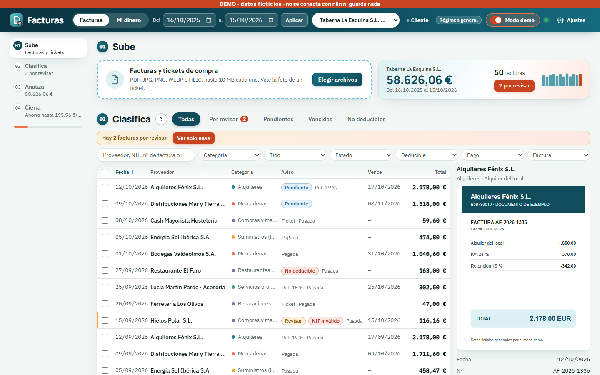

*La vista Facturas (en Modo demo, con datos ficticios): arriba el periodo y el cliente, a la izquierda los capítulos 01-04, en el centro la lista y a la derecha el documento.*

---

## 2. Puesta en marcha

Se hace una sola vez. Las instrucciones completas, con todos los detalles, están también en el [README](../README.md).

### Qué necesitas
- Un ordenador con Windows y **Docker Desktop** (el programa que mantiene n8n funcionando en segundo plano).
- Una clave gratuita de Gemini (la IA de Google), de <https://aistudio.google.com/apikey>.

### Paso a paso
1. **Instala y abre Docker Desktop.**
2. **Arranca n8n.** n8n es el programa que hace el trabajo «detrás de la web». Abre PowerShell en la carpeta del proyecto (`C:\ProyectosClaude\facturas`) y ejecuta:
   ```
   docker compose -f n8n\docker-base\docker-compose.yml -f n8n\docker\docker-compose.override.yml up -d --build
   ```
   Espera un minuto y comprueba que <http://localhost:5678> abre n8n. Cuando reinicies el ordenador, n8n vuelve a arrancar solo al abrir Docker Desktop.
3. **Abre la web con el lanzador (recomendado).** Haz doble clic en `iniciar-facturas.cmd` (en la carpeta del proyecto): arranca Docker y n8n si hace falta, espera a que respondan, levanta la «puerta» HTTPS (Caddy) y abre **https://localhost** en el navegador. Para pararla, `parar-facturas.cmd` (no apaga n8n). La web usa entonces la misma dirección para todo y **no hace falta tocar la URL de Ajustes**. La primera vez, el navegador puede avisar de que el certificado no es de confianza: ejecuta una vez `caddy trust` (te pide confirmar) o entra por `http://localhost:8080`. Detalles en `n8n/caddy/README.md`. Sigue valiendo abrir `web/index.html` con doble clic (modo antiguo, sin instalación ni escáner con cámara en algunos navegadores).
4. **Pruébala sin tocar nada: Modo demo.** En la cabecera verás un interruptor **Modo demo**. Al activarlo aparece una franja naranja («DEMO · datos ficticios · no se conecta con n8n ni guarda nada») y la web se llena de datos inventados. Es perfecto para aprender: no gasta IA, no escribe nada y al apagarlo vuelves a tus datos reales.
5. **Conecta con tus datos reales.** Con el Modo demo apagado, pulsa **Ajustes**:
   - **URL de los webhooks de n8n:** si entras por el lanzador (`https://localhost`) se rellena sola con la de ese sitio. Con el archivo suelto, normalmente `http://localhost:5678/webhook` (sin barra al final).
   - **Token (cabecera X-API-Key):** tu clave de acceso. Es el valor de `FACT_API_KEY` de tu archivo `.env` (no lo copies en ningún otro sitio ni lo compartas).
   - Pulsa **Probar conexión** y luego **Guardar**. Arriba debe aparecer el indicador de conexión en verde.

   Estos dos datos **se guardan solo en tu navegador**.

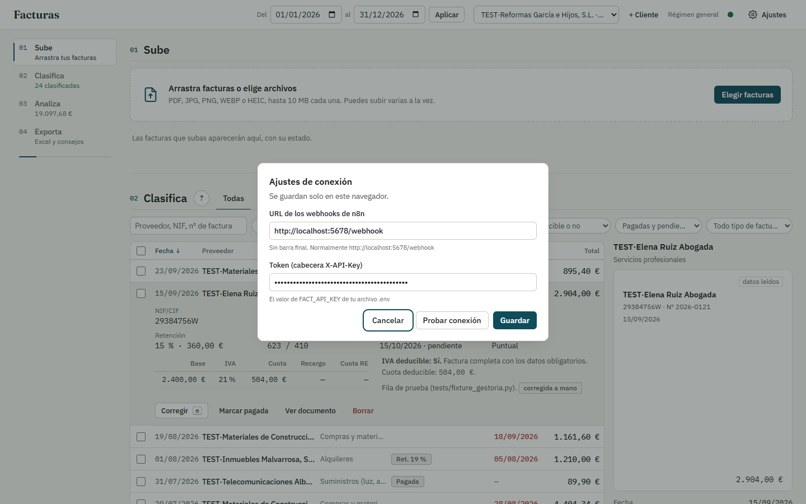

*Ajustes: dos campos y tres botones.*

> Si es tu primera instalación completa (credencial de Gemini en n8n, workflows, tablas), sigue los pasos 3 a 5 del README. Si el sistema ya está montado, con lo anterior te basta.

---

## 3. Recorrido por la web

### 3.1 La cabecera (siempre visible)

| Elemento | Para qué sirve |
|---|---|
| **Facturas / Mi dinero** | Cambia de vista. «Facturas» es el trabajo con documentos; «Mi dinero» son tus finanzas personales. |
| **Del … al … + Aplicar** | El **periodo** que analizas. Cambia las fechas y pulsa **Aplicar**. |
| **Selector de cliente** | «Todos los clientes» o uno concreto. La lista, los gráficos, el trimestre y el Excel se filtran por él. Junto a él aparece su régimen de IVA (por ejemplo «Régimen general»). |
| **+ Cliente** | Da de alta un cliente: nombre, NIF, régimen de IVA (general, recargo de equivalencia, simplificado o particular) y prorrata. |
| **Modo demo** | Datos ficticios para enseñar o aprender, sin conexión. |
| **Indicador de conexión** | Un punto de color con el texto «Sin conectar» o el estado de la conexión. |
| **Ajustes** | URL y clave (ver arriba). |

Si falta configurar la conexión, aparece una franja: «Falta conectar con n8n», con un botón **Abrir ajustes**.

### 3.2 Vista Facturas: cuatro capítulos

A la izquierda hay un índice con los capítulos **01 Sube · 02 Clasifica · 03 Analiza · 04 Cierra**. Es un recorrido natural: subes, revisas, miras el resumen y cierras el trimestre.

#### 01 Sube
- Arrastra tus archivos a la zona punteada o pulsa **Elegir archivos**. Valen **PDF, JPG, PNG, WEBP y HEIC**, de hasta **10 MB** cada uno. Puedes subir varios a la vez.
- En el móvil (pantallas táctiles) aparece además **Hacer foto**, que abre la cámara para fotografiar un ticket.
- Debajo ves cómo va cada archivo: la categoría, el total y el estado (por ejemplo **Correcta**, **Revisar**, **Duplicada**).
- Al lado, una tarjeta de resumen rápido: gasto del periodo, número de facturas y, si las hay, un botón naranja «N por revisar».
- Si tienes un cliente elegido, las facturas van a ese cliente. Si no, la herramienta intenta asignarlas sola según el **NIF del destinatario** (si coincide con el de un cliente tuyo); si no, van a «Personal».

#### 02 Clasifica
Aquí está la lista de facturas. Es la pantalla donde más tiempo pasarás.

**Pestañas rápidas:** Todas · Por revisar · Pendientes · Vencidas · No deducibles.

**Buscar y filtrar:**
- El cuadro de búsqueda encuentra por **proveedor, NIF, número de factura o importe** (vale «1161,60» o «1.161,60»).
- Seis desplegables: Categoría, Tipo (puntual, suscripción, contrato), Estado, Deducible, Pago y Factura (completas, tickets, rectificativas).
- Pulsa los encabezados **Fecha, Proveedor, Vence** y **Total** para ordenar. Abajo eliges 50, 100 o 200 facturas por página.

**Leer una factura:** pasa el ratón por una fila y déjalo quieto un instante (o muévete con el teclado): la fila se despliega y a la derecha verás el documento. Mientras haces scroll con la rueda no se abre ni se cierra nada, así que puedes recorrer la lista sin que la página se mueva; para ver otra factura, mueve el ratón hacia ella. **Pulsa la fila (o Enter) para fijarla**: se queda abierta aunque pases el ratón por otras, con el aviso «Fijada» en la vista previa; vuelve a pulsarla, pulsa otra fila o `Esc` para soltarla. En el móvil, un toque abre la fila y otro la pliega. Al abrir una fila se muestra el detalle: NIF, número de recepción, tipo de factura, desglose de IVA por tipo, retención, cuenta contable, si es deducible y por qué.

**Acciones de cada fila:** **Corregir**, **Marcar pagada**, **Ver documento** y **Borrar** (es un borrado suave: la factura queda marcada como borrada).

**Corregir:** cambia cualquier dato. Al guardar, el sistema **recalcula todo** (totales, deducibilidad, cuentas…) y vuelve a comprobar si cuadra. Si cambias la categoría o la cuenta, **lo recuerda para ese proveedor** y lo aplica a las siguientes facturas suyas (es una «regla aprendida»).

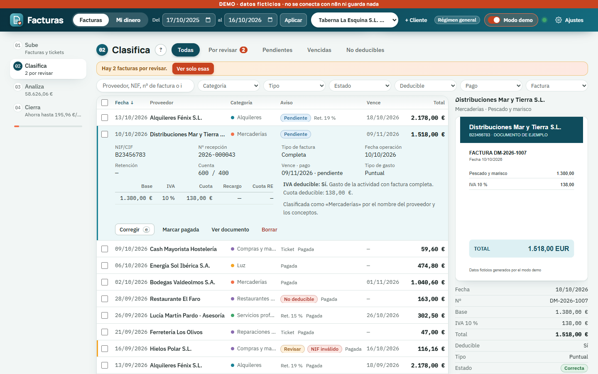

*Una fila desplegada: se ven el desglose, la cuenta (600 / 400) y los botones Corregir, Marcar pagada, Ver documento y Borrar.*

**Trabajo en lote:** marca varias casillas (o la de la cabecera para todas las visibles) y aparece una barra con:
- elegir una **categoría** y pulsar **Aplicar**;
- escribir una **cuenta** y pulsar **Aplicar**;
- **Marcar pagadas**;
- **Borrar**;
- **Quitar selección**.

**Atajos de teclado** (funcionan cuando no estás escribiendo en un campo; el botón **?** junto a «Clasifica» también los recuerda):

| Tecla | Acción |
|---|---|
| `/` | Ir al cuadro de búsqueda |
| `j` / `k` | Bajar / subir de fila |
| `e` | Corregir la fila actual |
| `x` | Seleccionar o quitar la fila actual |
| `Ctrl+Z` | Deshacer el último cambio |
| `?` | Mostrar la lista de atajos |

#### 03 Analiza
La foto general del periodo:
- **Tarjetas** con el gasto total y su comparación con el periodo anterior, el número de facturas y el gasto recurrente al mes y al año.
- **Evolución mensual:** barras con el gasto de cada mes (pasa el ratón para ver el detalle).
- **Reparto por categoría:** un gráfico circular con los porcentajes.
- **Suscripciones y contratos:** el último importe de cada uno, con su coste mensual y anual.

Las cifras salen **siempre en euros**; las facturas en otra moneda se convierten (ver apartado 5).

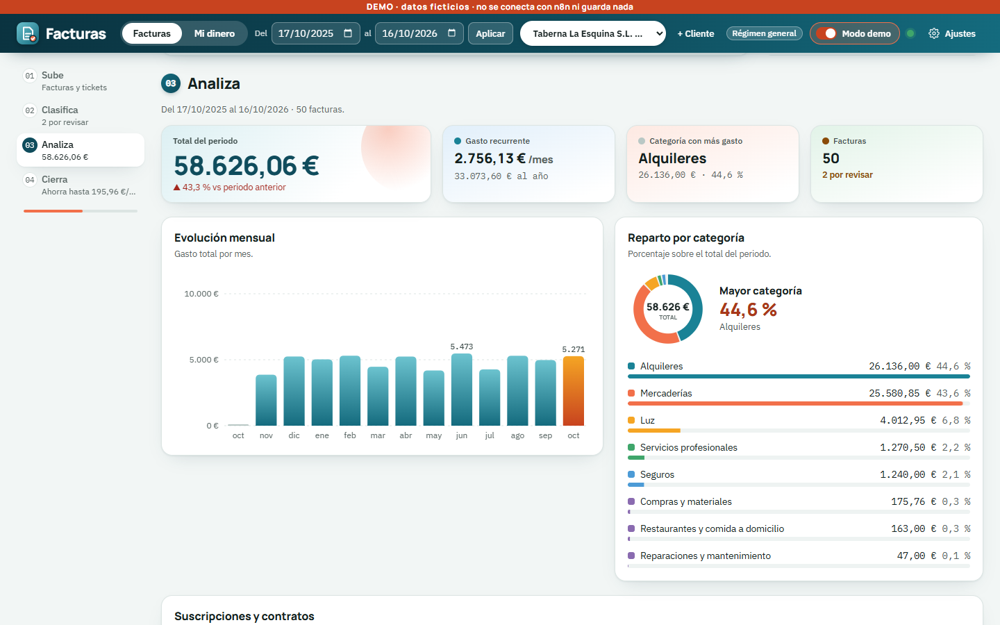

#### 04 Cierra el trimestre
Es el capítulo de la gestoría, aunque cualquiera puede mirarlo.

**Trimestre fiscal.** Elige **Año** y **Trimestre** (1T-4T) y pulsa **Calcular**. Conviene tener un cliente elegido. Verás:
- **IVA soportado (303):** base, cuota y parte deducible por tipo de IVA, más intracomunitarias e inversión del sujeto pasivo.
- **Retenciones:** modelo 111 (profesionales) y 115 (alquileres), con perceptores, base y retención.
- **Modelo 349:** operaciones con empresas de la UE.
- **Modelo 347:** terceros por encima de 3.005,06 € al año, con el detalle por trimestres.
- **Avisos** debajo: facturas sin IVA deducible, facturas por revisar que ya cuentan en el cálculo, NIF inválidos…

Después, los botones de **Descargar para el trimestre**:

| Botón | Qué te da | Para qué |
|---|---|---|
| Libro registro de recibidas (.xlsx) | Excel con el libro registro | Verlo y revisarlo |
| Asientos (.xlsx) | Excel con los asientos contables | Verlo y revisarlo |
| Libro registro de recibidas (CSV) | Texto con campos separados por `;` | Importarlo en otro programa |
| Asientos CSV | Lo mismo, formato propio | Importarlo en tu contabilidad |
| Asientos A3 (a validar) | Plantilla para A3 | **Probar antes con una importación de prueba** |
| Compras Holded | Plantilla de compras de Holded | Importarlo en Holded (algún detalle por validar) |

Regla práctica: **los CSV y los formatos A3 y Holded son para importar en un programa; si solo quieres ver los datos en Excel, usa .xlsx.**

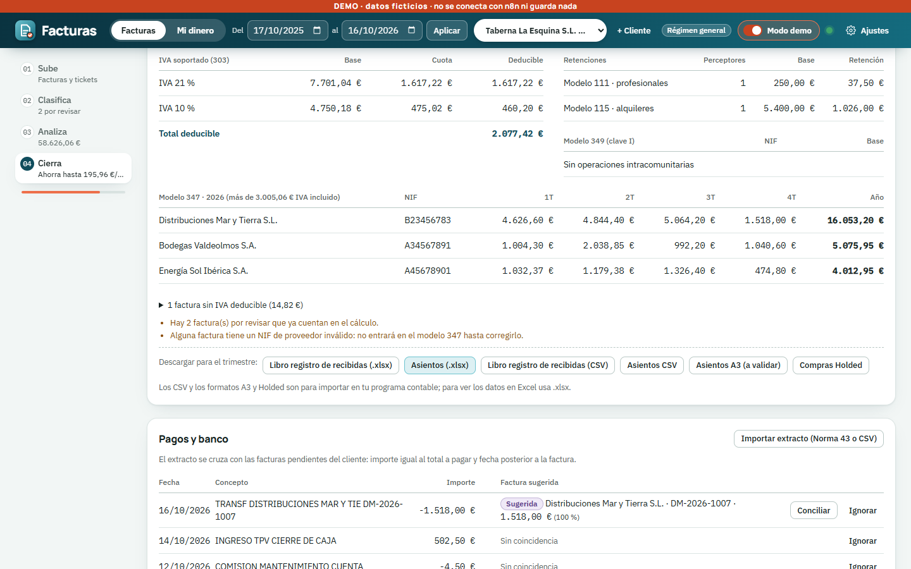

**Pagos y banco.** Pulsa **Importar extracto (Norma 43 o CSV)** y sube el extracto de tu banco. Norma 43 es un formato estándar de extractos bancarios en España; el CSV es el «Excel de texto» que casi todos los bancos permiten descargar. Cada movimiento se cruza con las facturas pendientes del cliente: el importe debe coincidir con el total a pagar y la fecha debe ser posterior a la de la factura.
- Si hay coincidencia, aparece una etiqueta **Sugerida** con la factura y la confianza (%). Pulsa **Conciliar** y la factura pasa a **pagada**, con la fecha del movimiento.
- Si no te interesa un movimiento (una comisión, por ejemplo), pulsa **Ignorar**.
- Si importas dos veces el mismo extracto, no se duplica nada.

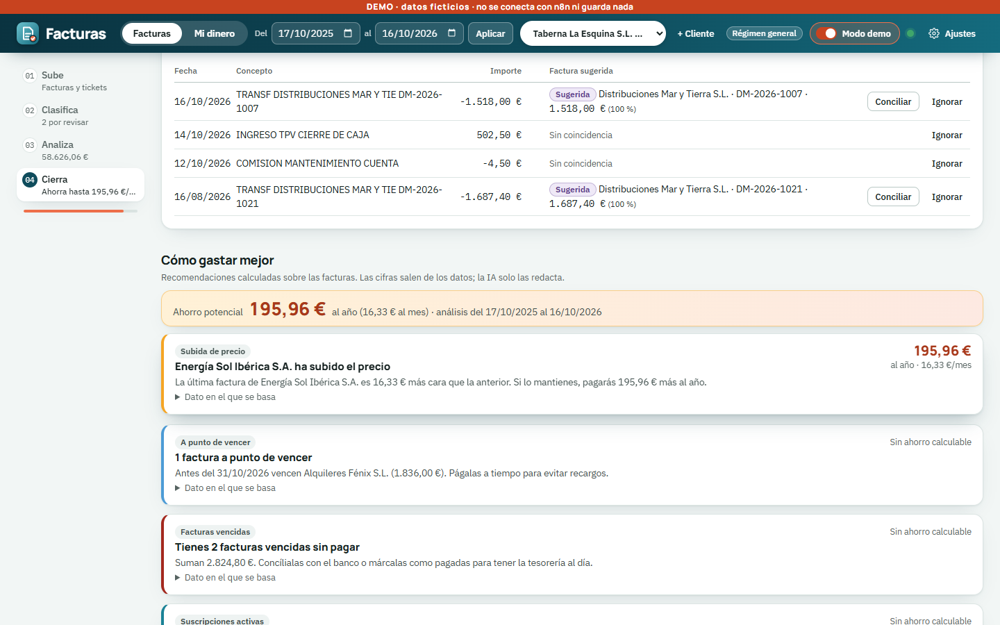

**Cómo gastar mejor.** Tarjetas de recomendación con el dato en el que se basan (desplegable «Dato en el que se basa»): subidas de precio, suscripciones solapadas, facturas a punto de vencer o ya vencidas, etc. Arriba, el **ahorro potencial** anual. El botón **Analizar de nuevo** las recalcula (esto gasta una petición a la IA, pero solo para *redactar* el texto; los números los pone el código).

**Tu Excel.** El botón **Exportar Excel** descarga `Gastos_AAAA-MM-DD.xlsx` con 11 hojas: Resumen, Facturas, Por mes, Suscripciones y contratos, Recomendaciones, Libro registro, IVA trimestre, Retenciones, 347, Asientos y Pendientes de pago. Los totales son **fórmulas reales**: si cambias un dato en el Excel, se recalculan.

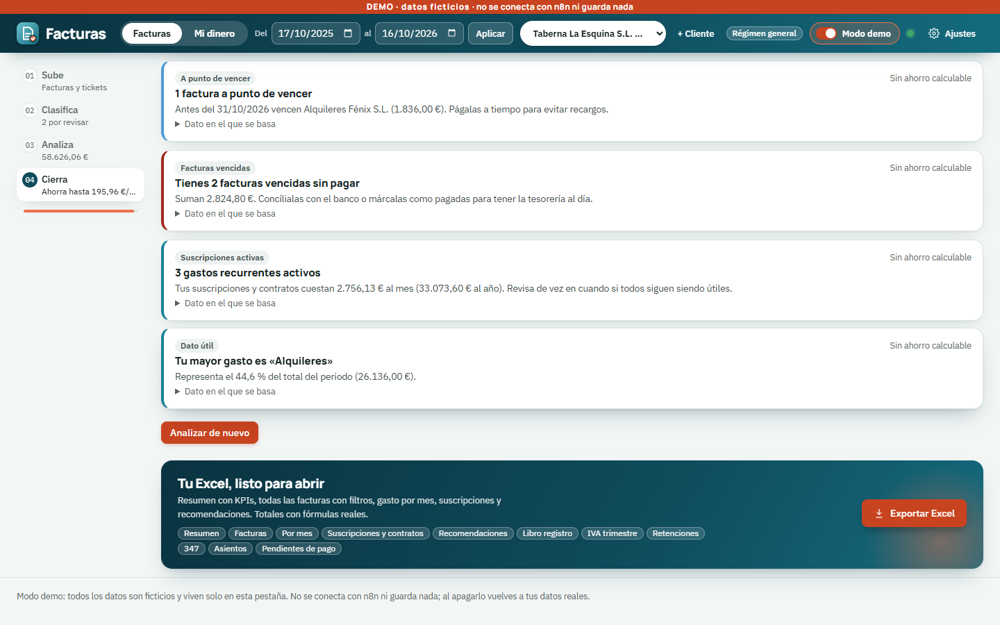

### 3.3 Vista Mi dinero (finanzas personales)

Pulsa **Mi dinero** en la cabecera. Cambia el menú de la izquierda; arriba tienes un selector de **Mes** (con flechas ‹ ›) y el botón **Añadir ingreso**. Si el cliente elegido no es un particular, la web te avisa de que «Mi dinero está pensado para finanzas personales».

Los gastos salen de tus facturas y tickets. Los ingresos, presupuestos, metas y deudas los pones tú.

| Sección | Qué encuentras |
|---|---|
| **01 Resumen** | Ingresos, gasto, ahorro del mes y tasa de ahorro; **previsión de fin de mes**; **alertas** (presupuesto superado, gasto que sube…); tabla comparando este mes, el anterior y la media de 3 meses; **Copiar resumen** |
| **02 Ingresos** (y presupuesto) | Tus ingresos del mes; la **regla 50/30/20**; presupuesto por categoría con colores: verde por debajo del 80 %, ámbar del 80 al 100 %, rojo si lo superas. Botón **Guardar presupuestos** |
| **03 Metas** | Metas de ahorro con barra de progreso y fecha objetivo; **Nueva meta** |
| **04 Deudas** | Préstamos e hipotecas: cuánto debes, intereses y qué pasa si amortizas antes (**Simular amortización**); **Nueva deuda** |
| **05 Renta** | Resumen del año para llevar a tu gestor. **Copiar resumen** y **Descargar CSV** |
| **06 Herramientas** | Calculadoras que no guardan nada: **Finiquito** y **Nómina** |

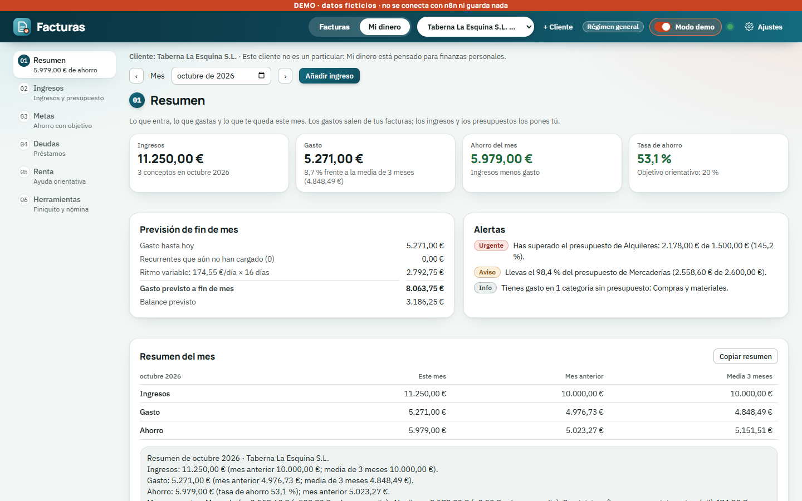

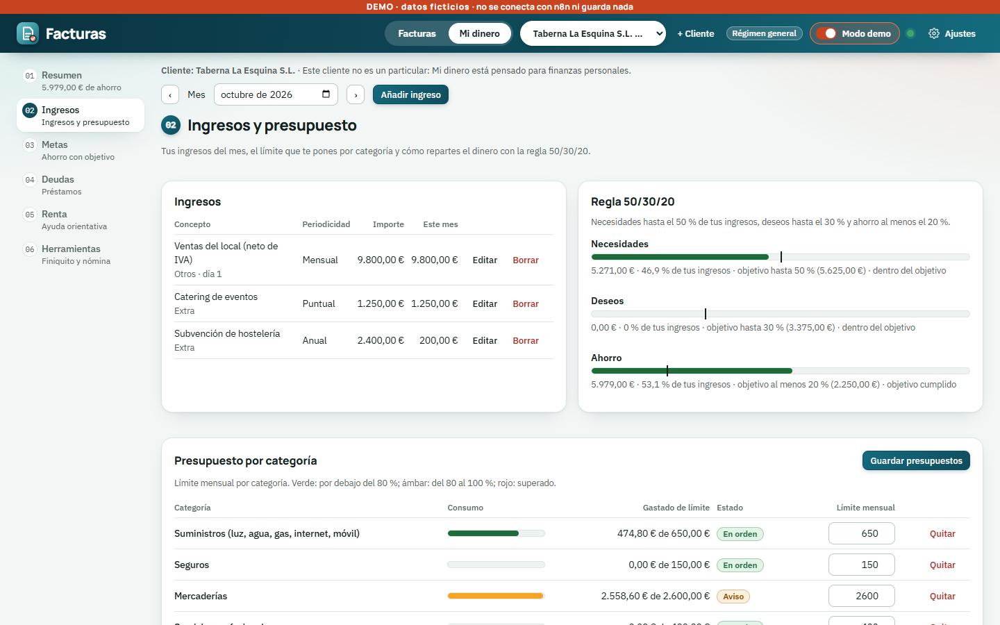

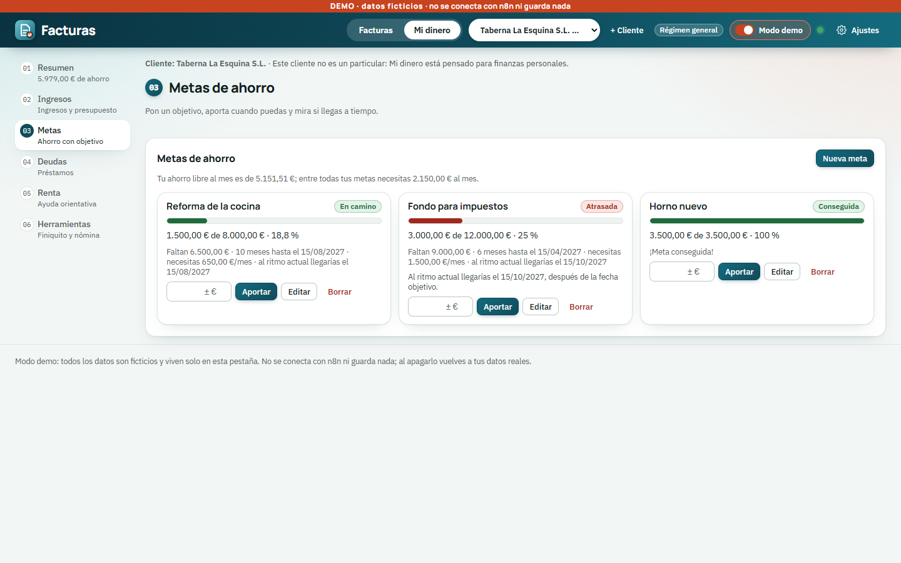

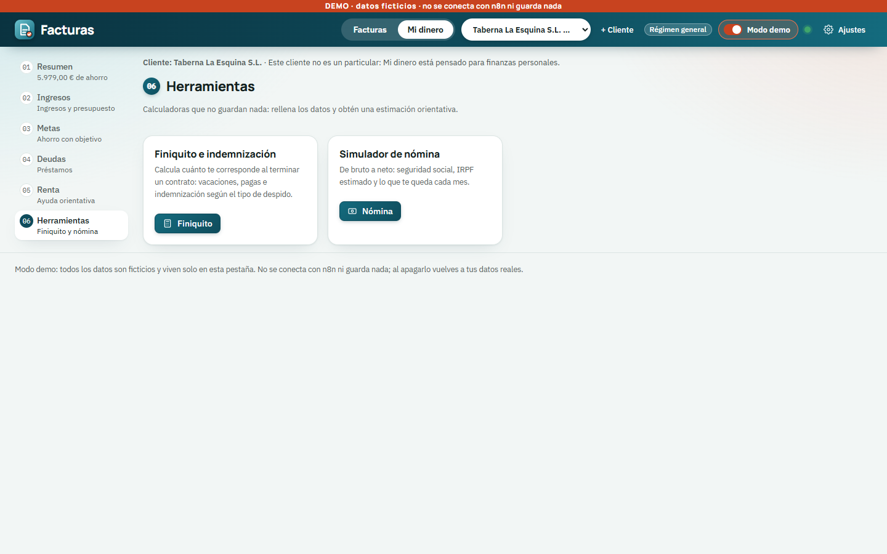

- **Finiquito e indemnización:** calcula vacaciones, pagas e indemnización según el tipo de baja.
- **Simulador de nómina:** de bruto a neto (Seguridad Social, IRPF estimado y lo que te queda cada mes).

Borrar una meta o una deuda pide una segunda pulsación («¿Seguro?») para evitar accidentes.

### 3.4 En el móvil

La web se adapta al móvil: la vista previa lateral se oculta y se abre con **Ver documento**; la fila se abre tocándola; aparece **Hacer foto**.

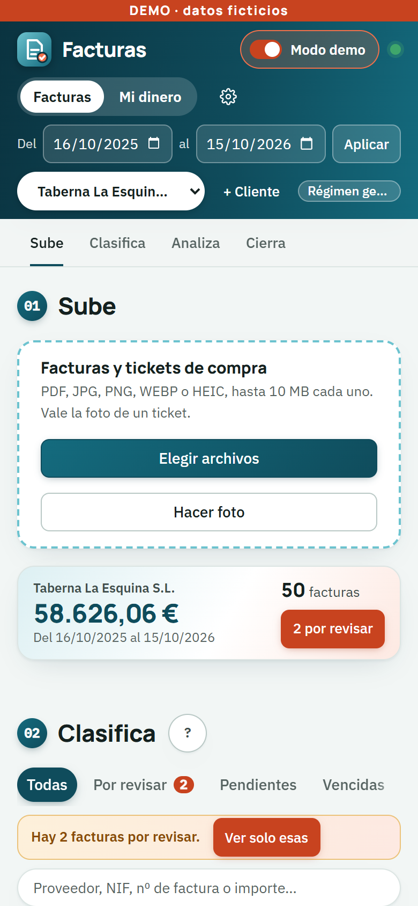

### 3.5 Instalar la aplicación (PWA), escáner de tickets y acceso desde el móvil

**Instalarla como aplicación.** Entrando por `https://localhost` (o por la dirección de Tailscale, más abajo), la web se puede instalar como una aplicación con su icono y ventana propia, en PC y móvil: en **Ajustes** pulsa **Instalar aplicación**, o usa el menú del navegador (Chrome: ⋮ → Instalar Facturas). En iPhone/iPad: Compartir → Añadir a pantalla de inicio. El icono trae dos atajos: **Hacer foto de un ticket** y **Mi dinero**. Sin conexión se abre la aplicación, pero con aviso «Sin conexión»: **los datos de facturas nunca se guardan en el dispositivo**, así que sin red no verás datos nuevos. Cuando haya una versión nueva aparece «Hay una versión nueva — Actualizar».

**Escáner de tickets.** Al subir **una** foto (con **Hacer foto** en el móvil o eligiendo una imagen) se abre el escáner: detecta el ticket, endereza la perspectiva, quita sombras y mejora el contraste, todo **en tu navegador** (la foto sin procesar no sale del equipo). Puedes arrastrar las 4 esquinas (o usar las flechas del teclado; Mayús = salto grande), elegir **Color mejorado**, **Escala de grises** o **Blanco y negro**, **Rotar 90°**, **Añadir otra foto (ticket largo)** para unir varias en una sola imagen, **Repetir**, **Usar original** (sube la foto tal cual) o **Aceptar** (sube `<nombre>_escaneado.jpg`). Si no encuentra el ticket verás «Ajusta las esquinas». Con **varias imágenes a la vez** se procesan solas y se avisa (las que no se detectan se suben como estaban). No se aplica a PDF; las fotos HEIC se suben tal cual (el navegador no las lee). Se puede desactivar en **Ajustes → Escanear fotos de tickets automáticamente**. Limitaciones: tickets muy arrugados, fotos sin contraste (papel claro sobre mesa blanca) o con el papel cortado por el borde pueden necesitar ajustar las esquinas a mano.

**Desde el móvil o fuera de casa (Tailscale).** Instala Tailscale en el PC y en el móvil (misma cuenta). En el PC, con la web en marcha: `tailscale serve --bg --https=443 http://localhost:8080`; en el móvil abre `https://<equipo>.<tailnet>.ts.net`. Solo lo ven tus dispositivos. La clave de acceso (token) se introduce una vez en el móvil, en Ajustes.

---

## 4. Cómo funciona por dentro

Sin jerga: la web es solo el «mostrador». El trabajo lo hace **n8n**, un programa que encadena pasos automáticos. Cada paso se llama *nodo*, y una cadena de nodos, *workflow*.

### De la foto a la lista

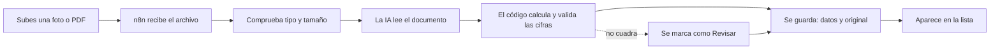

1. **Subes el archivo.** n8n comprueba que es de verdad un PDF o una imagen (mira el contenido, no solo la extensión) y que no pesa más de 10 MB.
2. **La IA lee.** Se envía a Gemini y devuelve los datos en orden: proveedor, NIF, fecha, líneas, IVA por tipo, total…
3. **El código calcula y valida.** Aquí no interviene la IA. Se comprueba que base + IVA = total (con tolerancia de 2 céntimos), que la fecha no sea futura, que el NIF sea válido, etc. También se calcula la parte deducible, la cuenta contable y la conversión a euros.
4. **Se guarda.** Los datos van a una tabla y el original a una carpeta de tu disco.
5. **Aparece en la lista**, con su estado: Correcta, Revisar o Posible duplicada.

### La arquitectura

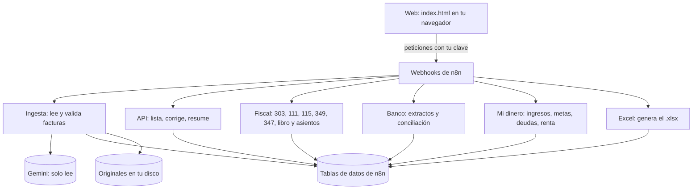

Un **webhook** es una «puerta» (una dirección web) a la que la web envía cada petición. Las **tablas** (Data Tables de n8n) son donde viven los datos: facturas, clientes, reglas aprendidas, categorías, movimientos del banco, ingresos, metas, deudas, recomendaciones y errores.

### La regla de oro

> **La IA solo lee. Todas las cifras las calcula código, y se pueden comprobar.**

- La IA nunca suma, nunca calcula IVA, nunca decide una deducción. Solo extrae lo que está impreso en el documento y, en los consejos, redacta frases.
- Los consejos pasan un control: si la IA escribe una cifra que no está en los datos, **se descarta su texto** y se usa una plantilla fija con los datos reales.
- El cálculo está comprobado con pruebas automáticas que lo comparan con un cálculo independiente (ver el [mapa de documentos](#10-mapa-de-documentos-del-proyecto)).
- Cuando algo no cuadra, **no se inventa nada**: se marca como «Revisar» y te lo enseña.

---

## 5. Qué hace con cada tipo de documento y qué significan los avisos

### Tipos de documento

| Documento | Qué hace la herramienta |
|---|---|
| **Factura completa** | Extrae proveedor, NIF, número, fechas, desglose de IVA por tipo (21, 10, 4 %…), retención y total. Valida que cuadre. |
| **Ticket (factura simplificada)** | Lee también las líneas de lo que compraste y la hora. Si trae «IVA incluido» sin desglose, base y cuota se **calculan en código**. Un ticket sin NIF ni número no es un error, pero su IVA no será deducible si el cliente es una empresa. Si la foto sale borrosa o cortada, queda en **Revisar**; si solo se ve el total y ningún dato de IVA, también (no se inventa el IVA). |
| **Abono o rectificativa** | Se guarda con importes en negativo y con la etiqueta **Rectificativa**. Mientras no se pague aparece **Abono a compensar** (se compensa en el siguiente pago al proveedor). |
| **Moneda extranjera** | El importe se guarda en su moneda y se convierte a euros con el tipo de cambio del BCE de la fecha de la factura; verás la moneda (por ejemplo USD) y su equivalente en euros. Si no hay tipo de cambio, **no se suma** al total: nunca se mezclan monedas. |
| **Con retención (IRPF)** | Se anota la retención («Ret. 15 %»), se separa el total de lo que **realmente pagas** y entra en el modelo 111 (profesionales) o 115 (alquileres). |
| **Compras a la UE o con inversión del sujeto pasivo** | Se marcan como «Intracomunitaria» o «Inversión sujeto pasivo»; el IVA se autorrepercute y va a las casillas correspondientes. |

### Estados de una factura

| Texto en la web | Significado |
|---|---|
| **Correcta** | Todo cuadra. En la lista no se destaca. |
| **Revisar** | Algo no encaja (por ejemplo base + IVA ≠ total, o la IA dudaba). **Cuenta en los cálculos** hasta que la corrijas. |
| **Posible duplicada** | Mismo proveedor, número e importe que otra del mismo cliente. Se guarda para que decidas. |
| **Duplicada** | Es exactamente el mismo archivo que otro ya subido: no se guarda dos veces. |
| **Rechazada** | El archivo no es de un tipo admitido o pesa demasiado. |
| **Error** | La IA no respondió. No se guarda; puedes volver a subirla. |
| **Borrada** | La has borrado: no cuenta en nada. |

### Avisos de la columna «Aviso»

| Texto | Qué significa y qué hacer |
|---|---|
| **Vencida** | No está pagada y su fecha de vencimiento ya pasó. Págala o concílala. |
| **Pendiente** | No pagada, aún dentro de plazo. |
| **Pagada** | Pagada (porque el documento lo dice, por el método de pago o por conciliación bancaria). |
| **No deducible** | El IVA de esta factura no se puede deducir (ticket sin NIF, cliente en recargo de equivalencia, falta el número…). Pasa el ratón para ver el motivo. |
| **Deducción dudosa** | Zona gris, por ejemplo restauración o viajes. Decide tú o consulta. |
| **NIF inválido** | El dígito de control del NIF del proveedor no es correcto. Corrígelo; mientras tanto no entra en el 347. |
| **Ret. 15 %** (o el % que sea) | Lleva retención de IRPF. |
| **Ticket · Rectificativa · Abono a compensar** | El tipo de documento. |
| **Intracomunitaria · Inversión sujeto pasivo · Extracomunitaria · Importación · Exenta** | El tipo de operación, si no es la normal (interior). |
| **Revisar · Posible duplicada** | Ver la tabla de estados. |

Además, encima de la lista puede aparecer una franja «Hay N facturas por revisar» con el botón **Ver solo esas**.

---

## 6. Qué es estimación y qué no

La herramienta distingue entre **cálculos sobre tus datos** y **estimaciones orientativas**.

| Cosa | Cómo tomarla |
|---|---|
| Totales, IVA por tipo, retenciones, libro registro, asientos | Cálculos sobre tus facturas, comprobables. Aun así, son una **ayuda para preparar** los modelos: revísalos con tu programa antes de presentar. No presenta nada ante Hacienda. |
| **Finiquito** | **Estimación orientativa.** El convenio colectivo o tu contrato pueden mejorarla. No cubre casos especiales (salarios de tramitación, FOGASA, ERE…). |
| **Nómina** | **Estimación.** No usa bases ni topes de cotización reales ni la tabla oficial de retenciones (hijos, situación familiar…). |
| **Renta** | **Orientativa.** Resume tu año para llevarlo a la gestoría; no calcula la cuota ni sustituye a la declaración. Todo lo que podría deducirse va marcado «A revisar con tu gestor». |
| **Deudas** | Orientativa: interés fijo, sin comisiones ni seguros vinculados. |
| **Asientos A3** | **«A validar».** No hemos podido comprobar el formato oficial de importación; prueba primero con una importación de prueba. |
| **Compras Holded** | Nombres y orden de columnas verificados con la ayuda oficial; algunos detalles del fichero (separador, claves de IVA reducido, formato de retenciones) están **«a validar»**. El recargo de equivalencia no se exporta. |
| **Consejos de ahorro** | Los números salen de tus datos; la IA solo redacta. Son sugerencias, no asesoramiento financiero. |
| **Cuota de Gemini gratuita** | La clave gratuita da unas **20 peticiones al día por modelo**. Cada factura nueva usa una. Si se agota, la factura sale con estado **Error** y puedes reintentarla más tarde. |

---

## 7. Privacidad y seguridad

| Pregunta | Respuesta |
|---|---|
| ¿Qué sale de mi ordenador? | **El contenido de cada factura o ticket, que se envía a Gemini (Google) para leerlo.** Para el tipo de cambio se consulta al BCE, pero solo con la moneda y la fecha. No se envía nada más a ningún otro servicio. |
| ¿Qué se queda en local? | Todos los datos guardados (tablas de n8n): clientes, ingresos, metas, deudas… y los **originales** de las facturas. |
| ¿Dónde están los originales? | En `C:\Users\GOMEZ\facturas-almacen`, **fuera de OneDrive** para que no se suban a la nube. |
| ¿Cómo se protege el acceso? | Todas las llamadas de la web a n8n llevan una **clave de acceso** (cabecera `X-API-Key`). Sin ella, n8n responde que no (error 403). |
| ¿Dónde se pone la clave? | En tu archivo `.env` local, en la credencial «FACT API Key» de n8n y en **Ajustes** de la web (se guarda solo en tu navegador). No la subas a ningún repositorio ni la compartas. |
| ¿Y la clave de Gemini? | Vive en el gestor de credenciales de n8n. |
| ¿Los avisos de error incluyen mis facturas? | No. Los correos de error no incluyen el contenido de las facturas. |
| Copias de seguridad | Las copias del volumen de n8n (`n8n_data-backup-*.tgz`) son **sensibles**: contienen la clave que cifra las credenciales. Guárdalas con cuidado. |

---

## 8. Preguntas frecuentes y problemas habituales

**La página no carga, o `localhost:5500` no abre nada.**
`localhost:5500` solo existe si tú has arrancado un servidor en ese puerto. Lo más sencillo: abre `web/index.html` con doble clic. Recuerda que n8n está en `http://localhost:5678`, no en el 5500.

**Pone «Sin conectar» o sale un error de conexión.**
1. Abre Docker Desktop y comprueba que el contenedor de n8n está en marcha.
2. Abre <http://localhost:5678>. Si no carga, n8n no está arrancado.
3. Revisa en **Ajustes** que la URL es `http://localhost:5678/webhook` (sin barra final).
4. Si sirves la web desde un puerto que no está entre los permitidos, el navegador la bloqueará.

**Dice que la clave o el token no es válido.**
El token de **Ajustes** debe ser exactamente el de `FACT_API_KEY` de tu `.env` y el de la credencial «FACT API Key» de n8n. Vuelve a pegarlo con cuidado (sin espacios) y pulsa **Probar conexión**.

**Una factura sale con estado «Error».**
Casi siempre es la cuota diaria de la IA gratuita (unas 20 peticiones por modelo y día). Vuelve a subirla más tarde. Si un workflow falla, llega un correo «[FACT] Error en …» con el enlace a la ejecución.

**El Excel descargado «no cuadra» con la web.**
- Comprueba que el **periodo y el cliente** de la cabecera son los mismos con los que descargaste.
- Las facturas **borradas y duplicadas no se exportan**.
- Las facturas en otra moneda se muestran convertidas a euros; las que no tienen tipo de cambio no suman.
- Los totales son fórmulas: si has cambiado datos en el Excel, se recalculan.

**Descargué un CSV y se ve todo en una columna.**
Los CSV son para **importar** en otro programa. Para ver los datos en Excel usa los botones **(.xlsx)**.

**El botón .xlsx dice que no puede cargar el generador de Excel.**
Los .xlsx que se crean en la propia web usan una librería que se descarga de internet **la primera vez**. Conéctate a internet e inténtalo de nuevo; mientras tanto, puedes usar el CSV.

**No veo mis datos reales, solo facturas inventadas.**
Tienes activado el **Modo demo** (franja naranja arriba). Apágalo con el interruptor.

**En Modo demo no puedo abrir Ajustes.**
Es normal: en demo no hay conexión («Modo demo: no hay conexión con n8n»). Apaga el interruptor y abre Ajustes.

**¿Se puede deshacer un borrado?**
Borrar es «suave»: la factura queda marcada como borrada y no cuenta en nada. `Ctrl+Z` deshace el último cambio hecho en la lista.

**¿Puedo empezar de cero?**
Sí, pero es una acción técnica: ejecuta a mano en n8n el workflow «FACT — Utilidad: vaciar fact_facturas». No borra los originales de la carpeta de archivos.

**Descargué el libro registro o los asientos y el archivo solo tiene la cabecera.**
Es que no hay facturas de ese cliente en el trimestre elegido (por defecto, el trimestre en curso). Tras la descarga, la web lo avisa con «sin datos: no hay facturas en este trimestre». Cambia el año o el trimestre en el capítulo 04 y vuelve a descargar.

**Pulsé «Guardar» dos veces y no se duplicó nada.**
Es a propósito: un segundo envío idéntico del mismo formulario en menos de un segundo y medio se ignora. Si cambias algún dato y vuelves a enviar (por ejemplo, recalcular un finiquito), sí se procesa.

**Un cliente nuevo muestra «Este cliente aún no tiene facturas en el periodo elegido».**
No es un error: aún no hay nada en esas fechas. Sube la primera en el capítulo 01 o amplía el periodo. El mensaje «No hay facturas con estos filtros» solo sale cuando hay algún filtro puesto.

**¿Por qué me sale «Gas» con Endesa (o «Luz» con Energía XXI)?**
Porque la categoría de luz, gas, agua y telefonía se decide por lo que dice la factura (potencia y kWh de electricidad, «factura de gas», m³ de agua, líneas y fibra), no por la marca: Endesa, Iberdrola o Naturgy venden luz y gas. Si una factura sale con la categoría equivocada, ábrela, cambia la categoría y guarda: queda corregida y, en estas cuatro categorías, el sistema no aprende una regla por proveedor (así una factura de gas de Endesa no arrastra a las de luz). Si el aviso dice «La categoría (X) no coincide con el contenido de la factura (parece Y)», revisa cuál es la correcta. El nombre del archivo solo es una pista débil: si pones «AGUA» a una factura de luz, manda el contenido.

---

## 9. Glosario

| Término | Qué es |
|---|---|
| **Base imponible** | El importe de la factura **antes** de IVA. |
| **IVA** | Impuesto sobre el valor añadido: porcentaje que se suma a la base (21 %, 10 %, 4 %). |
| **IVA soportado / deducible** | El IVA que pagas en tus compras y que, si es deducible, puedes restar del IVA que cobras. |
| **No deducible** | IVA que no se puede restar (por ejemplo, un ticket sin NIF de un cliente empresa). |
| **Retención / IRPF** | Parte del importe que quien paga retiene y entrega a Hacienda por cuenta de quien cobra (por ejemplo, el 15 % en una factura de un profesional). Lo que pagas es el total menos la retención. |
| **Modelo 303** | Declaración trimestral del IVA. |
| **Modelo 111** | Declaración trimestral de retenciones de profesionales y trabajadores. |
| **Modelo 115** | Declaración trimestral de retenciones de alquileres. |
| **Modelo 349** | Resumen de operaciones con empresas de la UE. |
| **Modelo 347** | Declaración anual de operaciones con terceros por encima de 3.005,06 €. |
| **Libro registro** | Listado ordenado de las facturas recibidas (o emitidas) de un negocio. |
| **Asiento contable** | Anotación en la contabilidad: qué cuenta se carga (debe) y cuál se abona (haber) por cada factura. |
| **Cuenta PGC** | Código del Plan General Contable (por ejemplo 600 compras, 629 otros servicios, 400 y 410 proveedores y acreedores). |
| **Conciliación** | Cruzar un movimiento del banco con la factura que paga. |
| **Norma 43** | Formato estándar de extractos bancarios en España. |
| **ISP (inversión del sujeto pasivo)** | Caso en que el IVA no lo cobra el proveedor, sino que lo autoliquida quien compra. |
| **Operación intracomunitaria** | Compra o venta con una empresa de otro país de la UE. |
| **Recargo de equivalencia** | Régimen de comercios minoristas: el proveedor cobra un recargo además del IVA y el comercio no lo deduce. |
| **Prorrata** | Porcentaje del IVA que se puede deducir cuando se hacen actividades con y sin derecho a deducción. |
| **NIF / CIF / NIE** | Identificación fiscal de personas y empresas. La web comprueba su dígito de control. |
| **Rectificativa (abono)** | Factura que corrige o anula otra anterior; sus importes van en negativo. |
| **Suplido** | Gasto que pagas en nombre de otro y se factura sin IVA (por ejemplo, una tasa). |
| **Tipo de cambio (BCE)** | Cotización oficial del Banco Central Europeo para convertir a euros. |
| **Regla aprendida** | Al corregir la categoría o la cuenta de un proveedor, la herramienta lo recuerda para sus siguientes facturas. |
| **n8n / workflow / webhook** | n8n: el programa que automatiza los pasos. Workflow: una cadena de pasos. Webhook: la «puerta» a la que la web envía las peticiones. |
| **Regla 50/30/20** | Reparto orientativo de ingresos: hasta 50 % necesidades, hasta 30 % deseos y al menos 20 % ahorro. |

---

## 10. Mapa de documentos del proyecto

| Carpeta / archivo | Qué hay |
|---|---|
| `README.md` | Puesta en marcha y uso, resumidos. Apunta a esta guía. |
| `CLAUDE.md` | Documentación técnica detallada del sistema (para quien lo mantiene o amplía). |
| `web/index.html` | La web completa, en un solo archivo. |
| `docs/GUIA.md` | **Esta guía.** |
| `docs/diseno-gestoria.md` | Diseño del modo gestoría: esquema, fiscalidad, formatos. |
| `docs/auditoria-contable.md` | Auditoría contable que originó el modo gestoría. |
| `docs/finanzas-personales.md` | Hoja de ruta y reglas de cálculo de «Mi dinero», finiquito, nómina, renta y deudas. |
| `docs/prueba-restaurante.md` | Caso de prueba con un restaurante. |
| `docs/prueba-autonomo.md` | Caso de prueba con un autónomo (empresa y finanzas personales): hallazgos y correcciones. |
| `docs/GUIA.pdf` | Esta guía en PDF (se regenera con `tests/generar_guia_pdf.js`). |
| `docs/rediseno/` | Dirección, auditorías y capturas del rediseño de la web (las imágenes de esta guía están en `docs/rediseno/auditorias/capturas/`). |
| `n8n/workflows/` | Los workflows exportados en JSON, por si hay que volver a importarlos. |
| `n8n/codigo/` | Código fuente de los pasos de cálculo (fiscal, banco, Excel, finiquito, Mi dinero…). |
| `n8n/docker-base/` y `n8n/docker/` | Cómo se arranca n8n con Docker. |
| `tests/` | Facturas de ejemplo y scripts que comprueban que todo cuadra (Python y pruebas de la web con Playwright). |
| `.env.example` | Plantilla de configuración, sin claves. Tu `.env` real es local y secreto. |

---

*Mantén esta guía al día: cuando cambie la web (botones, secciones, atajos), actualiza también este documento.*
